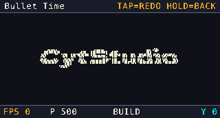
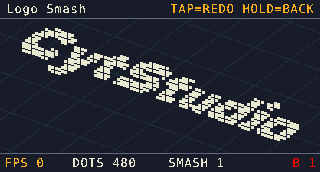
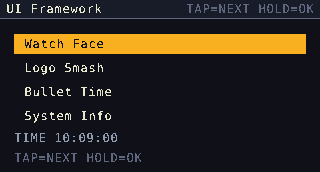
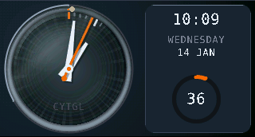

<div align="center">

**简体中文** | [English](README.md)

# CytGL

**面向微控制器的、与硬件无关、不使用堆的保留模式图形界面框架。**

CytGL 以水平条带渲染屏幕并逐条推送给面板，因此不需要帧缓冲。它提供控件树、带转场动画的页面与导航模型、组不透明度、单一注入时钟与固定步长调度、点阵字体，以及一套软件光栅化器。它不含 `malloc`、不调用 libm、不包含任何 HAL 头文件，也不硬编码面板几何。

[](LICENSE)
[](#)

<div align="left">

- 语言：C11，不使用编译器扩展，无生成文件，无第三方依赖。
- 依赖：仅 `<stdint.h>`、`<stdbool.h>`、`<stddef.h>`。
- 许可证：Apache License 2.0。
- 版本：0.1.0（`CGL_VERSION_STRING`）。
- 参考平台：STM32G431CB（Cortex-M4，128 KB Flash / 32 KB RAM），经 SPI + DMA 驱动 320×172 的 ST7789 面板。

---








## 1. 为什么采用条带渲染

320×172 的 RGB565 帧缓冲占 110 KB。参考器件只有 32 KB RAM，因此"先在内存中合成整帧、再一次性传送"的常规做法无法采用。CytGL 改为把屏幕切成 `CGL_CFG_BAND_H` 行（默认 4 行）高的水平条带，在光栅化一条带的同时由总线移出上一条带。两条交替使用的条带缓冲各为 `CGL_CFG_SCREEN_W * CGL_CFG_BAND_H` 像素，整条流水线因此占用 5 KB 而不是 110 KB。

其余设计都由这一决定推导而来：

- 推送给面板的条带必须是完整的，因此每条带都从控件树根开始绘制；没有局部条带重绘，也不保存上一帧；
- 控件必须自行绘制自己占用的整个矩形，因为没有任何机制会恢复背景；
- 组不透明度合成器按条带保存自身覆盖的区域再混合回去，其正确性正建立在"条带被完整绘制"之上。

---

## 2. 提供的能力

| 领域 | 内容 |
|---|---|
| 基础类型 | RGB565 颜色、点、矩形（两端闭区间）、输入事件、唯一的混合公式 |
| 画布 | 条带画布，携带裁剪、平移与非线性变形；像素、线、矩形、圆盘、方点、位块传送；抗锯齿圆、粗线与圆弧；逐图元的墨色不透明度；组不透明度暂存区 |
| 整数数学 | 16 位角度、带线性插值的 Q8 正弦/余弦、极坐标映射、范围比例、整数平方根 |
| 字体 | 8×16 与 12×24 ASCII 点阵字体，行优先，bit0 为最左像素 |
| 控件树 | 绝对坐标的父子树、裁剪、剔除、子树平移、子树变形、命中测试、事件分发、单一全局损坏汇 |
| 内置控件 | `cgl_panel`（背景/边框）、`cgl_label`（定长文本，自制整数格式化）、`cgl_bar`（任意有符号范围、两种取向、边框、分段、补间值） |
| 径向工具箱 | `cgl_arc`：覆盖率渐变、渐细抗锯齿指针光栅器、带可选烘焙表的着色径向表面、圆环仪表控件、五个画布图元的不透明度包装 |
| 表盘 | `cgl_watch`：着色盘面、嵌入式凹槽、分度环、三根渐细指针、轴心，可选彗尾与玻璃罩；自带时基与计数日历，无需 RTC |
| 显示 | 驱动虚表、双缓冲条带呈现与异步像素推送、损坏累积 |
| 时钟 | 全工程唯一的时钟：帧时间、固定步长逻辑调度、帧率统计 |
| 补间 | 整数 Q8 补间与缓动曲线 |
| 页面 | 携带生命周期虚表的页面对象、定长导航栈、每页的转场偏好、十一种转场行为 |
| 场景 | 显示 + 时钟 + 导航器 + 输入队列，对外只暴露"一帧" |

框架自身不持有任何硬件知识。时间经移植层的 `tick_ms` 进入，输入经其 `poll_input` 进入，像素经一张虚表离开。

### 核心性质

- **不使用堆。** 每个页面、控件、世界与缓冲都是静态或调用者声明的对象；尺寸是编译期预算。
- **无浮点、无 libm。** 全部绘制、计时与缓动都是整数或定点运算。
- **无 64 位除法。** 值到像素的映射在中间量超出 `int32_t` 时使用移位/减法长除法，避免引入 libgcc 辅助函数。
- **单一时间源。** 移植层报告硬件计时器读数，框架累积它并调度其余一切。不存在"必须先调用 A 再调用 B"的要求。
- **结构性冻结。** 只有导航栈顶页面接收逻辑步，因此被覆盖页面的仿真会停止且不累积欠账。
- **可观测的失败计数器。** 未能生效的 alpha、超限被拒绝的子控件、被拒绝的范围、被丢弃的事件、被拒绝与被丢失的导航请求，都是可读的数字，而不是靠肉眼猜测。

### 可选扩展模块

一个独立的附加模块位于自己的两棵树中（`include/ext/` 是它的 API，`src/ext/` 是它的实现），从不属于 `libcytgl.a`。不链接它的构建在 Flash 与 RAM 上均为零开销。

| 效果 | 引擎 | 绘制器 |
|---|---|---|
| 定点 2.5D 物理与投影 | `cgl_phys2d`（Q12.4 圆盘世界、均匀网格粗筛、非弹性求解器、仅用于表现的竖直轴）、`cgl_iso2d`（正交相机拟合、计数排序深度顺序）、`cgl_iso2d_phys2d`（唯一的桥） | 应用自行绘制，或使用模块的碎裂绘制器 |
| 粒子云 | `cgl_particles`（Q8.8，每粒子 12 字节，环绕相机，倒数表透视除法，生成的正弦表） | `cgl_particles_view` |
| 碎裂场景 | `cgl_debris`（位图到刚体云、相机拟合、SMASH/SETTLE 循环） | `cgl_debris_view` |
| 重力球 | `cgl_bounce`（半隐式重力、四壁、恢复系数、按身份自愈） | `cgl_bounce_view` 与一个独立小球控件 |

引擎的编译单元只包含 C 自由标准库头文件。绘制器文件是唯一包含 `cgl_canvas.h` 的部分，且只在构建图中存在框架时才被加入模块目标。

---

## 3. 构建

```bash
cmake -B build -DCYTGL_PORT_TEMPLATE=OFF
cmake --build build
# -> build/libcytgl.a
```

CMake 选项：

| 选项 | 默认 | 作用 |
|---|---|---|
| `CYTGL_BUILD_TESTS` | `OFF` | 构建宿主（PC）回归测试并注册到 CTest |
| `CYTGL_BUILD_EXAMPLES` | `OFF` | 加入示例目录；其中的固件目标仅在具备 ARM 工具链与已签入工程设置时才有实际作用 |
| `CYTGL_BUILD_EXT` | `OFF` | 构建可选扩展模块（`cytgl_ext`，别名 `cytgl::ext`，`libcytgl_ext.a`） |
| `CYTGL_PORT_TEMPLATE` | `ON` | 把 `src/port/cgl_port_template.c` 作为语法检查编译 |

安装规则把 `libcytgl.a` 放入 `lib/`，把头文件放入 `include/cytgl/`。工程不生成 `find_package` 配置，请通过 `add_subdirectory()` 或 `FetchContent()` 消费该目标。

### 作为子项目引入

```cmake
add_subdirectory(third_party/CytGL)
target_link_libraries(my_app PRIVATE cytgl::cytgl)
```

### 不使用 CMake

把 `src/core`、`src/render`、`src/port` 下的全部 `.c`（`src/port/cgl_port_template.c` 除外）加入工程，并把 `include/` 加入包含路径。

**不要**把 `src/core` 与 `include/` 同时加入全局包含路径。框架源码以纯文件名包含自己的头文件，该写法在源文件所在目录内解析；全局路径项会使私有的 `cgl_screen.h` 与公共头文件产生歧义。仅 `include/` 一项即可同时服务 `<cytgl/...>` 与 `<ext/...>`。

### 宿主回归测试

```bash
cmake -B build/host -DCYTGL_BUILD_TESTS=ON -DCYTGL_BUILD_EXT=ON
cmake --build build/host
ctest --test-dir build/host --output-on-failure

ctest --test-dir build/host -R alpha_test --output-on-failure   # 单个测试
```

测试编译并运行真实的框架源码，只把显示驱动替换为写入内存数组的模拟实现，因此断言检查的就是出货代码路径。渲染类测试还会写出可直接打开的 `frameNN.ppm` 与 `.bmp` 快照。面板驱动与条带呈现之间的唯一接缝是 `cgl_display_drv_t` 虚表，这正是上述做法得以成立的原因。

---

## 4. 一页纸移植

需要提供三样东西，通过一个描述符一次性交给框架。

### 4.1 显示驱动

```c
typedef struct cgl_display_drv
{
    const char *name;

    int  (*init)(void *ctx);                                       /* 上电            */
    void (*set_window)(void *ctx, uint16_t x0, uint16_t y0,
                       uint16_t x1, uint16_t y1);                  /* 开窗，闭区间     */
    void (*write_pixels)(void *ctx, const cgl_color_t *px,
                         uint32_t count);                          /* 异步推送        */
    void (*wait_idle)(void *ctx);                                  /* 等待总线空闲     */
    void (*set_backlight)(void *ctx, uint8_t percent);             /* 可以为 NULL     */

    int16_t width;   /* 必须等于 CGL_CFG_SCREEN_W */
    int16_t height;  /* 必须等于 CGL_CFG_SCREEN_H */
} cgl_display_drv_t;
```

- `init` 成功返回 0，非零结果会中止启动。
- `set_window` 接受面板空间中的闭区间坐标。若面板可见区位于更大的 GRAM 内，在此补上偏移。
- `write_pixels` 必须启动一次异步传输后立即返回。像素率取决于这一点：框架把"光栅化下一条带"与"传送本条带"重叠起来。缓冲的有效期到 `wait_idle()` 返回为止。`count` 是像素数，不是字节数。
- `wait_idle` 阻塞到该传输完成，延后的总线清理（例如释放片选）属于这里。
- `width` 与 `height` 必须是横向下的面板几何；不一致时框架拒绝启动。

### 4.2 移植描述符与帧入口

```c
#include <cytgl/cytgl.h>

static const cgl_display_drv_t my_display_drv = { /* 同上 */ };
static uint32_t my_tick_ms(void)     { return (uint32_t)HAL_GetTick(); }
static void     my_poll_input(void *user, uint32_t dt_ms);

static const cgl_port_t s_port = {
    .name        = "my-board",
    .display     = &my_display_drv,
    .display_ctx = &my_panel,
    .tick_ms     = my_tick_ms,
    .poll_input  = my_poll_input,     /* 可选；NULL = 无输入源 */
    .input_ctx   = NULL,
    .board_init  = my_board_init,     /* 可选：引脚、总线时钟、背光 */
    .board_ctx   = NULL,
};

static cgl_port_ctx_t g_port;

int main(void)
{
    board_init();                                  /* 时钟、引脚、生成代码的初始化 */

    if (cgl_port_bind(&s_port, &g_port, NULL) != 0)
    {
        Error_Handler();                           /* 板级、驱动或几何检查失败 */
    }

    for (;;)
    {
        (void)cgl_port_frame(&g_port);             /* dt + 输入 + 一帧 */
    }
}
```

第三个参数传 `NULL` 时，框架持有自己的静态导航器，并以整屏矩形初始化它。若应用需要把页面注册到自己能够访问的导航器上，则应传入自己的实例。

`cgl_port_frame()` 读取 `tick_ms()`、计算经过时间、调用 `poll_input(dt)`，然后推进一帧。当应用自己掌握节拍时，也可以跳过 `cgl_port_frame()` 直接调用 `cgl_screen_frame()`，此时输入扫描由调用者以同样的 `dt` 驱动。

### 4.3 输入

框架自身从不轮询任何设备；它每帧调用一次移植层的轮询钩子，并传入该帧的 `dt`——这是唯一能按真实经过时间推进去抖的地方。把扫描结果翻译成 `cgl_event_t` 并投递：

```c
cgl_event_t ev = { .kind = CGL_EV_KEY_DOWN, .key = 0, .hold_ms = key_hold_ms() };
(void)cgl_port_post_event(&g_port, &ev);
```

两条规则：**只投递，不分发**（屏幕在帧边界统一投递事件，因此页面不会在帧中间被进入或离开）；保持**单一生产者**，使扫描与去抖集中在一处。事件类型为 `CGL_EV_KEY_DOWN / REPEAT / LONG / UP`、`CGL_EV_TOUCH_DOWN / MOVE / UP` 与 `CGL_EV_BACK`。触摸支持除了投递 `CGL_EV_TOUCH_*` 之外不需要任何额外工作，命中测试已经存在。

单键板卡的常见做法是把一次长按翻译为 `CGL_EV_KEY_LONG` 后紧跟一个 `CGL_EV_BACK`。消费该长按的页面把它读作"确认"；不消费的页面则让随后的 `CGL_EV_BACK` 到达导航器并弹栈。

### 4.4 移植清单

- [ ] 已实现显示驱动；失败时 `init` 返回非零。
- [ ] `set_window` 使用面板坐标且两端闭区间。
- [ ] `write_pixels` 在启动异步传输后立即返回。
- [ ] `wait_idle` 阻塞到传输完成，然后释放片选。
- [ ] `width`/`height` 等于 `CGL_CFG_SCREEN_W`/`CGL_CFG_SCREEN_H`，且为横向。
- [ ] `tick_ms` 单调递增。
- [ ] `poll_input`（若使用）只投递事件，从不自行分发。
- [ ] `cgl_port_bind()` 返回 0，且首帧有画面。

---

## 5. 一帧

```
cgl_port_frame(&port)                dt = tick_ms() - last_tick（回绕安全）
  poll_input(dt)                     移植层的按键或触摸扫描；只投递事件
cgl_screen_frame(&screen, dt)
  1. cgl_clock_begin(dt)             全工程唯一累积时间的地方
  2. 在帧边界排空输入队列
  3. cgl_page_nav_frame()            提交导航、推进转场
  4. while (cgl_clock_next_step())   定步逻辑：page->on_step(step_ms)
  5. page->on_frame(&clock)          每帧一次：补间、状态机、文本刷新
  6. cgl_widget_update_tree()        纯视觉动画
  7. cgl_display_present()           逐条带光栅化并推送
```

三条规则支撑整个设计。

1. **只有一个时间源。** 时钟是唯一累积时间的东西；移植层只报告硬件计时器读数，其余六步的顺序由框架保证。
2. **控件树只在帧的起点变化**，且只发生在 `cgl_page_nav_frame()` 内，并且总是在渲染之前。导航是被"请求"的，从不立即生效。
3. **逻辑与视觉是两个域。** 物理跑在 `on_step`（固定步长、可重放）；补间与文本刷新跑在 `on_frame`（跟随帧率）。

### 条带呈现

```
buffer[cur]  光栅化 -> set_window(条带) -> write_pixels（DMA，异步）  [CPU 继续]
buffer[!cur] 光栅化（此时 DMA 仍在移出上一条带）
                                       -> wait_idle() -> 下一个窗口 ...
```

一个损坏矩形会导致它覆盖到的每个完整条带被重绘。不透明度暂存区只由 CPU 写入、永不进入 DMA，因为此刻另一条带缓冲正被 DMA 读取。

---

## 6. 架构

四层，依赖严格单向：

```
        应用层（App）      页面、场景装配
         |  只向下依赖
      cgl_port.c/.h        板级移植层：把硬件与框架绑定的唯一文件
         |                 （显示虚表 + 时钟 + 输入源）
        CytGL              框架：类型 / 画布 / 字体 / 控件 / 显示 /
         |                 时钟 / 补间 / 页面 / 场景
         |                 <- 无 HAL 头、无 malloc、无 libm
      面板驱动              例如 ST7789            <- 只认识一条总线虚表
         |
        BSP/               板级：引脚、SPI、DMA、按键  <- 只认识 CubeMX 句柄
         |
       Core/ + Drivers/    生成代码

  include/ext + src/ext    位于这四层之旁：一个可选模块（定点物理与等轴测投影、粒子
         引擎、碎裂场景、重力球），每一项都是"框架无关的引擎 + 一层薄绘制器"。
         它的源码与公共 API 使用框架自己的两棵树，因此引入方式与框架一致：
         <ext/cgl_phys2d.h>。
```

可移植性的判据是：把库从本仓库复制到任何其他工程，它仍然可用——因为它不知道屏幕是什么，也不知道时间从哪里来。

### 三个解耦缝

| 缝 | 头文件 | 隔离的对象 |
|---|---|---|
| `cgl_display_drv_t` | `cgl_display.h` | 像素如何到达面板。替换为写内存数组的模拟驱动后，真实框架代码可以在 PC 上逐像素测试 |
| 总线虚表 | 示例工程中的 `Devices/lcd_bus.h` | 电信号如何离开芯片。硬件 SPI + DMA、软件模拟、并口与仿真器可以互换 |
| `cgl_widget_vt_t` | `cgl_widget.h` | 一个控件长什么样。新增控件 = 一个以 `cgl_widget_t` 为首成员的结构体加一张虚表 |

唯一未被抽象成缝的是损坏汇：它是全局单例，因此同一时刻只能有一个活动的场景。

### 页面与转场

页面是携带虚表的对象（`on_create`、`on_destroy`、`on_enter`、`on_exit`、`on_pause`、`on_resume`、`on_step`、`on_frame`、`on_event`），导航器是 `CGL_CFG_PAGE_STACK_MAX` 项的定长栈。`cgl_trans_t` 共 13 个取值：十一种转场行为，加上 `CGL_TRANS_NONE`（瞬间切换）与 `CGL_TRANS_AUTO`（按导航动作选择）。

转场的实现方式是给页面根控件设置一个偏移，因此不需要改动任何子控件。Genie（"吸入"）是同一接缝的非线性版本：在页面根上安装一个变形描述符，每个图元逐行重算落点，产生几何形变而不是像素重采样。`S_OUT` 与 `S_IN` 复用同一套漏斗，只是把吸入口移到右下角并叠加一条水平 S 形轨迹。

页面可以声明自己的转场偏好：

```c
cgl_page_set_trans_enter(page, CGL_TRANS_COVER_UP, CGL_PAGE_FX_KEEP_EASE, CGL_PAGE_FX_KEEP_MS);
```

解析顺序为：页面声明 → 调用者的请求 → 动作默认值。唯一的例外是显式传入的 `CGL_TRANS_NONE`，它总是优先，从而保证"这次瞬间切换"始终可表达。

### 组不透明度

```c
cgl_widget_set_alpha(&panel.base, 160u);   /* 0..255，255 = 不透明（默认） */
```

整个控件及其子树按条带隔离渲染，再作为一个整体合成到背景上，因此相互重叠的子控件不会被混合两次。当 `CGL_WF_CLIP` 置位（默认）时，隔离区域就是控件自身的 frame。把 `CGL_CFG_ALPHA` 设为 0 会将该功能整个编译掉，不分配任何暂存区，setter 退化为被计数的空操作。

---

## 7. 仓库结构

```
include/cytgl/           框架公共 API
  cytgl.h                单一入口：一次包含即引入全部 API
  cytgl_config.h         全部编译期开关
  cgl_types.h            RGB565 颜色、点、矩形、事件、混合公式
  cgl_math.h             整数三角、极坐标映射、整数平方根
  cgl_canvas.h           条带画布、软件光栅化、变形、墨色不透明度
  cgl_font.h             点阵字体
  cgl_widget.h           保留模式控件树
  cgl_panel.h            内置控件：背景与边框容器
  cgl_label.h            内置控件：文本标签
  cgl_bar.h              内置控件：进度与电平条
  cgl_arc.h              径向工具箱：着色表面、渐细指针、圆环仪表
  cgl_watch.h            内置控件：模拟表盘（建立在 cgl_arc 之上）
  cgl_display.h          显示虚表与条带呈现
  cgl_time.h             唯一的帧时钟
  cgl_anim.h             整数补间与 Q8 缓动曲线
  cgl_page.h             页面对象、导航栈、转场
  cgl_screen.h           显示 + 时钟 + 页面 + 输入 = 一帧
  cgl_port.h             移植契约

include/ext/             可选模块的公共 API，以 <ext/...> 引入
  cgl_ext_basis.h        共用的 Q12.4 约定与强制内联宏
  cgl_phys2d.h           定点圆盘物理（含 2.5D 竖直轴）
  cgl_iso2d.h            等轴测相机与计数排序深度顺序（不认识刚体）
  cgl_iso2d_phys2d.h     上述两层之间唯一的桥
  cgl_particles.h        Q8.8 粒子引擎（框架无关）
  cgl_debris.h           碎裂场景：位图到刚体云、相机拟合、循环
  cgl_bounce.h           重力球：重力、四壁、恢复系数
  cgl_particles_view.h / cgl_debris_view.h / cgl_bounce_view.h   条带绘制器
  cgl_*_config.h         编译期开关，按层拆分

src/core/                纯逻辑，完全与硬件无关
src/render/              条带呈现与 DMA 流水线
src/port/                移植胶水层（不含硬件代码，另有一份模板）
src/ext/                 可选模块的引擎（从不进入 libcytgl.a）

tests/                   宿主回归测试
tools/                   资源生成与检查工具
examples/                完整应用：两个 STM32 工程加共用代码
```

扩展模块的引擎只包含 C 自由标准库头文件，因此不链接它们的纯界面应用为零开销。所有需要绘制的部分都被拆到独立文件中，使数学部分保持框架无关并可单独单元测试。模块以可选加入的 CMake 目标 `cytgl::ext` 打包；只有链接它才会把模块的一个字节放进构建结果。

---

## 8. 资源占用

参考构建：随附示例应用运行在 STM32G431CB（Cortex-M4 @ 170 MHz，128 KB Flash / 32 KB RAM）上，`-O2`，`arm-none-eabi-gcc` 14.3，全部可选效果均已链接。

| 项目 | 字节 | 占比 |
|---|---|---|
| Flash（`text` + `data`） | 62 192 | 128 KB 的 47.5% |
| 仅静态数据（`.data` + `.bss`） | 30 856 | 94.2% |
| 栈预留（链接脚本中 `_Min_Stack_Size` = 0x540） | 1 344 | 4.1% |
| RAM 使用量（`data` + `bss` + 预留） | 32 200 | 32 KB 的 98.3% |
| 剩余未分配 | 568 | 1.7% |

Flash 与静态数据是 `arm-none-eabi-gcc` 14.3 的实测值；栈预留取自链接脚本，因此后三行是"该实测值 + 当前实际生效的预留"。物理可用栈 = 32 KB − 静态数据，全效果开启时为 1 912 B。

去掉两个动画页面后（`-DAPP_FX_SMASH=0 -DAPP_FX_PARTICLES=0`，由于再无引用，物理世界与粒子池也随之移除），同一套源码为 46 720 B Flash、15 968 B RAM。**约束是 RAM 而不是 Flash。**

框架在两者中都只占一小部分。大头是示例应用的物理世界（480 个刚体加碰撞网格）、表盘，以及配置启用的 5 KB 条带缓冲与 5 KB 不透明度暂存区。

可减少占用的旋钮：

| 旋钮 | 效果 |
|---|---|
| `CGL_CFG_ALPHA 0` | 完全移除不透明度暂存区：参考几何下约 5 KB RAM。`cgl_widget_set_alpha()` 变为被计数的空操作 |
| `CGL_CFG_BAND_H` | 条带缓冲 RAM 为 `2 * W * BAND_H * 2` 字节。减半约省 2.5 KB，代价是更多 SPI 开窗命令 |
| `CGL_CFG_LABEL_MAX_TEXT` | 每个标签 32 字节 |
| `CGL_CFG_PAGE_STACK_MAX` | 每个栈项 4 字节 |
| `CGL_CFG_WATCH_TRAIL 0` | 移除表盘的彗尾状态及其每帧损坏 |
| `CGL_CFG_WATCH_DIAL_LUT 0` | 移除 578 字节的烘焙盘面表，改为程序化着色 |
| `CGL_CFG_WATCH 0` | 移除表盘、其日历与损坏模型 |
| `CGL_CFG_ARC 0` | 移除整个径向工具箱（要求 `CGL_CFG_WATCH 0`） |
| `CGL_PHYS2D_MAX_BODIES` | 每个刚体 16 字节加 2 字节 |
| `CGL_PARTICLES_MAX` | 每个粒子 12 字节 |
| `-DCGL_CFG_PARTICLES=0` / `-DCGL_CFG_DEBRIS=0` / `-DCGL_CFG_BOUNCE=0` | 对按目录收集源文件的构建，清空对应效果的编译单元 |

---

## 9. 参考应用

`examples/STM32G431CBU6_CytStudio_Demo` 是一个完整应用：带选择条动画的菜单页；一个把重球砸向点阵徽标、将其碎裂为最多 480 个定点刚体、并用等轴测投影加画家算法深度排序渲染的页面；一个以半透明覆盖层呈现的信息页；一个演示"固定步长逻辑与可变时间尺度"的页面；以及一个基于 `cgl_watch` 控件、附带圆环仪表的表盘页。

STM32H563RGT6 示例在另一块板卡上运行同一个应用（SPI1 配 GPDMA1 通道 0、PWM 背光、按键极性相反），这正是可移植性主张的验证方式：页面、面板驱动与按键状态机是共用的，每个工程只保留自己的生成代码、引脚映射与 DMA 引擎。

在 CytStudio 中打开 `examples/STM32G431CBU6_CytStudio_Demo/CytGL.cproj` 即可构建该示例——CytStudio 自带固件所需的 ARM 工具链——或使用该工程自带的构建脚本。

### 工具

| 工具 | 用途 |
|---|---|
| `tools/mkfont.py` | 由 TTF 生成 `src/core/cgl_font_data.c` 的字形表；支持字号、笔画阈值与 dry-run 预览 |
| `tools/mklogo.py` | 由文字或图片生成点阵头文件，含网格尺寸与单元格访问函数 |
| `tools/mkparticletables.py` | 生成粒子引擎的正弦表与倒数表 |
| `tools/mkwatchlut.c` | 打印表盘模块的默认盘面表，再粘贴回源码 |
| `tools/ppm_view.ps1` | 在终端把 PPM 快照渲染为字符画，并提供针对单像素点阵的亮度阈值 |
| `tests/test_image_out.c` | 唯一的图像写出实现：由 RGB565 缓冲写出 PPM 与 24 位 BMP |

---

## 10. 设计规则

这些规则是承重的。违反其中任何一条都会产生难以定位的细微缺陷。

1. 库中不含 HAL 头文件、不含 `malloc`、不调用 libm，也不出现具体颜色或字号。它只依赖 C 标准库。
2. 时间只以 `dt_ms` 的形式进入。库从不读取硬件时钟。
3. 控件树只在 `cgl_page_nav_frame()` 内变化。导航始终是"请求"，从不立即生效。
4. `on_step` 每个步长执行且仅执行一次，并且只对栈顶页面执行，因此被覆盖页面的仿真从结构上冻结且不累积欠账。
5. 绘制图元各自只施加一次平移；内部函数只接受屏幕坐标。
6. 推送给面板的条带必须是完整的。组不透明度依赖这一点。
7. 虚表一律使用指定初始化器（`.type = ..., .draw = ...`），使结构体成员的增加不会静默改变顺序。
8. 会改变结构体布局的编译期开关——`CGL_PHYS2D_USER_STORAGE`、`CGL_CFG_PARTICLES`、`CGL_CFG_DEBRIS`、`CGL_CFG_BOUNCE`——是构建级的。取值不一致的两个编译单元不能共享受影响的同一个对象。

---

## 11. 许可证

CytGL 以 Apache License 2.0 发布。每个源文件头部都带有 `SPDX-License-Identifier`。

随附的第三方资源遵循各自的条款：

| 目录或文件 | 权利方 | 许可证 | 许可证正文位置 |
|---|---|---|---|
| `Drivers/STM32G4xx_HAL_Driver/**`、`Drivers/STM32H5xx_HAL_Driver/**` | STMicroelectronics | BSD-3-Clause | 同目录下的 `LICENSE.txt` |
| `Drivers/CMSIS/**` | Arm Limited | Apache-2.0 | `Drivers/CMSIS/LICENSE.txt` |
| `Drivers/CMSIS/Device/ST/**` | Arm / STMicroelectronics | Apache-2.0 | 同目录下的 `LICENSE.txt` |
| `Core/**`、`*.ld`、`startup_*.s`（生成代码） | STMicroelectronics | BSD-3-Clause | 同 HAL 驱动。只有 `main.c` 的 USER CODE 段属于本工程 |
| `src/core/cgl_font_data.c`（字形表） | DejaVu，源自 Bitstream Vera | Bitstream Vera | `licenses/LICENSE_DEJAVU.txt`；生成文件的 SPDX 为 `Apache-2.0 AND Bitstream-Vera` |
| `tools/DelaGothicOne-Regular.ttf` 及其光栅化得到的徽标点阵 | The Dela Gothic Project Authors | SIL OFL 1.1 | `licenses/LICENSE_DELAGOTHIC.txt`；生成头文件的 SPDX 为 `Apache-2.0 AND OFL-1.1` |

有两点需要明确：

- 本工程必须保持 **Apache-2.0**，不能改用 GPL-2.0：CMSIS 是 Apache-2.0，与 GPLv2 不兼容。
- 字形表与徽标点阵都是**字体的光栅化衍生物**，再分发前必须确认对应字体的许可证。它们不受覆盖库其余部分的 Apache-2.0 许可证约束。

Copyright (C) 2026 CytStudio &lt;cyte_studio@foxmail.com&gt;
